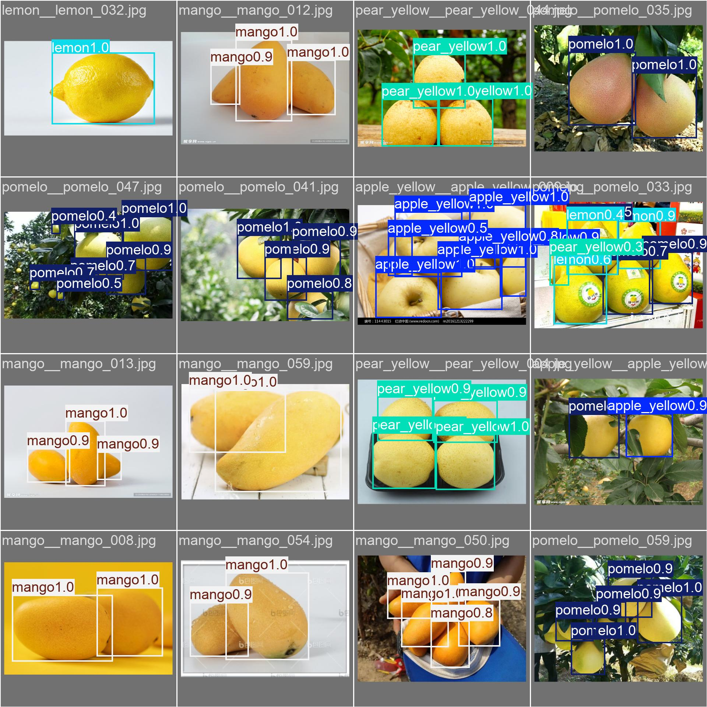
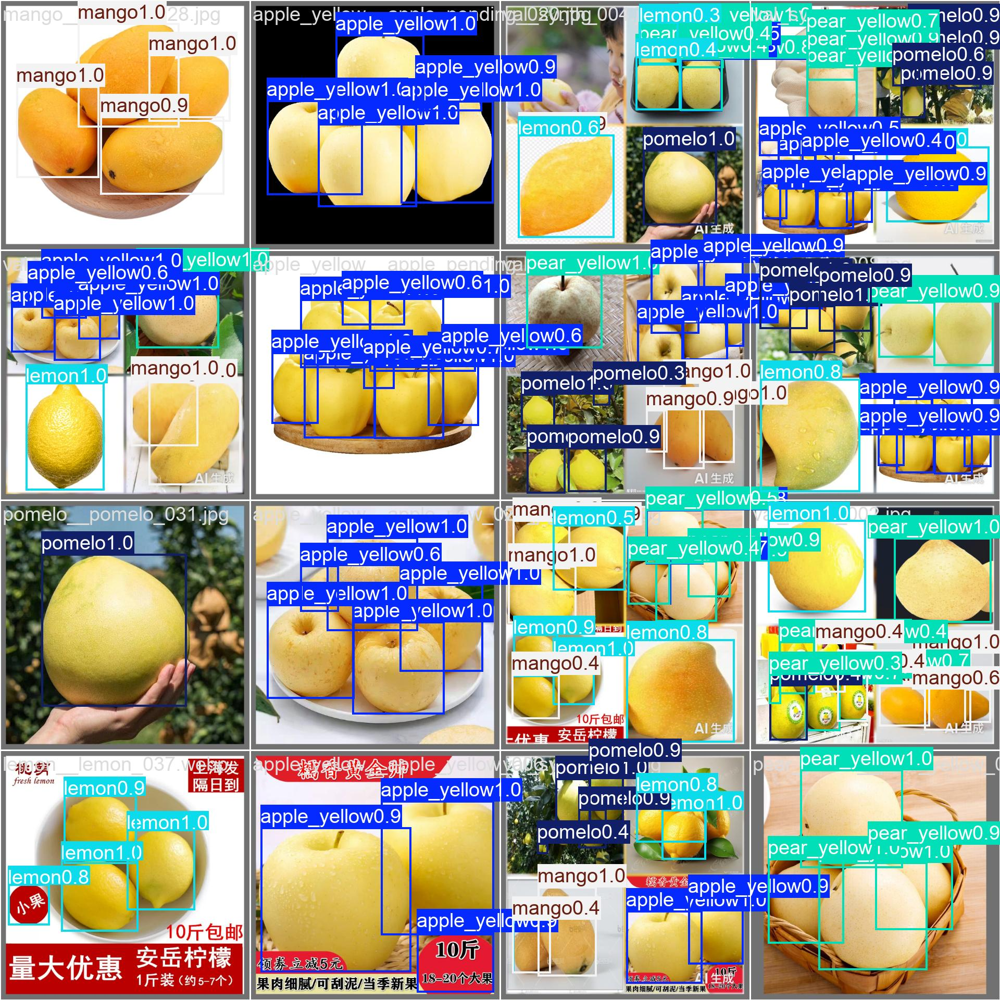

---
AIGC:
    Label: "1"
    ContentProducer: 001191440300708461136T1XGW3
    ProduceID: 2e55e772cb5d0bb106e5d06c937dff97_d40682f8c3b911f1a05452540064ee0f
    ReservedCode1: VZKYqyAKQsmTtpZGykEL8uiYTJRjiQ2CoBpSx5E8+FlcfCAzY1nzpxU53Eqb3dK2ZtO7ANlSpRn4e+mFdE47c1ZiTk+upE+Qj6Gu1z53eMhtYRQhSlBv3Qyg4M63Ts5N/RNXkcg75g7TfLMLRZQERogEQg3ArYRkK0sCK4BikEhmXynZNE0ZAJjO67k=
    ContentPropagator: 001191440300708461136T1XGW3
    PropagateID: 2e55e772cb5d0bb106e5d06c937dff97_d40682f8c3b911f1a05452540064ee0f
    ReservedCode2: VZKYqyAKQsmTtpZGykEL8uiYTJRjiQ2CoBpSx5E8+FlcfCAzY1nzpxU53Eqb3dK2ZtO7ANlSpRn4e+mFdE47c1ZiTk+upE+Qj6Gu1z53eMhtYRQhSlBv3Qyg4M63Ts5N/RNXkcg75g7TfLMLRZQERogEQg3ArYRkK0sCK4BikEhmXynZNE0ZAJjO67k=
---

# 黄色水果五类检测：从数据集构建到 RDK X5 边缘部署

基于 **YOLOv8s** 的黄色水果目标检测项目，完整覆盖：素材采集与自动预标注 → 人工复核 → 多果拼接合成 → 数据集分层划分 → 训练与评估 → 双版本 ONNX 导出 → RDK X5 BPU 量化编译 → 板端 int8 推理验证 → USB 摄像头实时检测。

这个项目的重点不是"跑通一次训练"，而是**把模型真正落到边缘设备上，并量化前后同口径复测精度**。

---

## 效果

### 检测精度

| 阶段 | 评估口径 | mAP50 | mAP50-95 |
|---|---|---|---|
| 本机 FP32 · val | ultralytics val（rect 推理） | **0.855** | — |
| 本机 FP32 · test | ultralytics val（rect 推理） | 0.820 | 0.766 |
| 本机 FP32 · test | letterbox 640 / conf 0.001 / NMS IoU 0.7 | 0.7828 | — |
| **RDK X5 int8 · test** | 同上（同口径可对比） | **0.7930** | — |

> 量化损失：int8 相对同口径 FP32 基线仅 **-1.02** 个点，基本无精度损失。

### 逐类精度（test 集，int8 vs FP32）

| 类别 | int8（RDK X5） | FP32（PC） |
|---|---|---|
| apple_yellow | 0.6752 | 0.6667 |
| lemon | 0.7451 | 0.7477 |
| mango | 0.8806 | 0.8375 |
| pear_yellow | 0.9556 | 0.9574 |
| pomelo | 0.7086 | 0.7047 |

### 板端运行性能

| 指标 | 数值 |
|---|---|
| 单帧推理延迟（batch=1, 640×640） | mean 31.1 / p50 29.9 / p90 35.9 / max 43.2 ms |
| 实时链路帧率（USB 摄像头 640×480 MJPG） | 约 18.9 FPS |
| 编译后模型体积（.bin） | 11.8 MB |
| 48 张 test 图推理 | 全部成功，无失败帧 |

### 鲁棒性消融实验

| 输入变换 | mAP50 | 相对基线 |
|---|---|---|
| 原始彩色 | 0.820 | — |
| 转灰度 | 0.773 | -5.7% |
| 色相旋转 180° | 0.813 | -0.7% |

结论：模型存在一定颜色依赖（灰度掉 5.7%），但对色相不敏感（旋转 180° 仅掉 0.7%），说明学到的主要是形状与明度特征，而非单纯的黄色先验。

---

## 检测效果

验证集预测结果（左为人工标注，右为模型预测）：





---

## 数据集

- **类别（5 类）**：`apple_yellow` / `lemon` / `mango` / `pear_yellow` / `pomelo`
- **规模**：train 325 / val 49 / test 48（按实例数与类别分布分层划分）
- **构建流程**：
  1. **素材采集**：网络图 + 实拍图，按"单果 / 多果同框"分类归档
  2. **质量分级**：按清晰度、遮挡程度自动分级，剔除切半果肉、非黄颜色等不合格样本
  3. **自动预标注**：用已有权重批量推理生成 YOLO txt，降低人工成本
  4. **人工复核**：导出为 X-AnyLabeling 工程，逐张修正
  5. **多果合成**：单果图抠图后拼贴为多果同框图，同步生成标注（含掩膜补洞与质量评估）
  6. **分层划分**：holdout 策略隔离验证/测试集，避免与训练集同源造成指标虚高

> 数据集本身不入库（体积大且含版权素材）。目录结构与 `data.yaml` 模板见 `configs/`。

---

## 目录结构

```
.
├── README.md
├── requirements.txt
├── .gitignore
├── LICENSE
├── configs/                    # 数据与训练配置
│   └── fruit_yellow.yaml       # 五类数据集定义（nc=5）
├── scripts/                    # 全流程脚本
│   ├── split_dataset.py        # 数据集分层划分 + 一致性校验
│   ├── make_mosaic.py          # 多果拼接合成（含掩膜补洞）
│   ├── prelabel.py             # 自动预标注 / 标注格式转换
│   ├── train.py                # 训练入口（参数化）
│   ├── evaluate.py             # 自建口径 mAP 评估
│   └── export_onnx.py          # ONNX 导出（标准版 / RDK X5 专用版）+ 数值校验
├── rdk_x5/                     # 板端部署全链路
│   ├── conversion/             # ONNX → BPU bin 转换配置（mapper.py）
│   ├── runtime_py/             # 板端推理运行时（det / cls / seg / pose）
│   ├── board_pkg/              # 前后处理工具包（letterbox / NMS / 可视化）
│   ├── calib/                  # 量化校准集
│   └── fruit_yellow_v1/        # ONNX 与编译产物（.gitignore 排除）
├── assets/                     # 部署辅助物料（.gitignore 排除，可由脚本重新生成）
│   ├── std_export/             # 标准版 ONNX / PT 导出产物
│   ├── x5_export/              # RDK X5 专用版导出产物 + 导出日志
│   └── export_monkey_patch_official.py
├── weights/                    # 本地权重缓存（.gitignore 排除）
├── FastSAM-s.pt                # 单果抠图权重（.gitignore 排除）
├── yolo11x-seg.pt              # 预标注 / 掩膜权重（.gitignore 排除）
└── docs/                       # 实验报告与踩坑记录
    ├── images/                 # 效果图与数据集样例
    └── RDKX5_int8_mAP50_复测报告.md
```

---

## 环境

**训练端（PC）**

| 项 | 版本 |
|---|---|
| GPU | NVIDIA RTX 5070 Laptop 12GB |
| Python | 3.11 |
| CUDA | 12.8（cu128） |
| 框架 | Ultralytics 8.x + PyTorch 2.7+ |

依赖安装：

```bash
pip install -r requirements.txt
# RTX 50 系需单独安装 cu128 版 torch
pip install torch torchvision --index-url https://download.pytorch.org/whl/cu128
```

**部署端（RDK X5）**

| 项 | 版本 |
|---|---|
| 硬件 | 旭日派 RDK X5（8GB，8 核） |
| 系统 | RDK OS（Ubuntu 22.04） |
| 工具链 | hb_mapper 1.24.3（Docker 环境运行） |
| 推理运行时 | hbm_runtime 3.0.9（系统预装） |
| 量化配置 | bayes-e 架构 / nv12 输入 / 1000 类校准集 38 张 |

---

## 快速开始

### 1. 准备数据

```bash
# 按 YOLO 格式整理：images/{train,val,test} 与 labels/{train,val,test}
# 修改 configs/fruit_yellow.yaml 中的 path 字段
```

### 2. 训练

```bash
python scripts/train.py \
  --data configs/fruit_yellow.yaml \
  --model yolov8s.pt \
  --imgsz 640 \
  --epochs 150 \
  --batch 16
```

### 3. 评估

```bash
# 官方口径
yolo detect val model=runs/detect/fruit_yellow_v1/weights/best.pt \
  data=configs/fruit_yellow.yaml split=test imgsz=640 rect=True

# 自建口径（letterbox + conf 0.001 + NMS IoU 0.7，与板端对齐）
python scripts/evaluate.py --pred-dir preds/ --gt-dir labels/test/
```

> **注意**：两种口径数值不可直接相减。官方 val 默认 rect 推理，板端走 letterbox，预处理不同会导致指标差异，比较时必须统一口径。

### 4. 导出 ONNX

```bash
# 标准版（Hailo / ONNX Runtime 等通用后端）
python scripts/export_onnx.py --model best.pt --out onnx/ --tag standard

# RDK X5 专用版（6 头输出，适配 BPU 算子）
python scripts/export_onnx.py --model best.pt --out onnx/ --tag x5
```

### 5. 编译为板端 bin

```bash
# 在 x86 Linux（Docker）环境执行
cd rdk_x5/conversion
python mapper.py --config fruit_yellow_v1.yaml
# 产物：*_bayese_640x640_nv12.bin
```

### 6. 板端推理

```bash
# 单图 / 批量推理
python runtime_py/main.py \
  --model /path/to/xxx.bin \
  --test-img /path/to/images \
  --label-file configs/fruit_yellow.names

# USB 摄像头实时检测（本地屏幕显示）
python runtime_py/usb_cam_demo.py --show --fullscreen
```

> **务必显式指定 `--label-file`**：板端 runtime 默认加载 COCO 80 类名单，不指定会把 0~4 号类别错套成 person / bicycle / motorbike 等。

---

## 踩坑记录

| # | 问题 | 原因 | 解决 |
|---|---|---|---|
| 1 | 板端 mAP 比本机低 2.7 个点 | 官方 val 用 rect 推理，板端用 letterbox，预处理不一致 | 建立同口径 FP32 基线后再比，实际量化损失仅 1.02 点 |
| 2 | 批量评测少算 2 张图 | 脚本按扩展名白名单筛图，漏掉 `.webp` | 改为遍历全部文件 + 读取失败跳过，不依赖白名单 |
| 3 | 板端类别名全错 | runtime 默认加载 COCO 80 类名单 | 显式传 `--label-file` 指定自定义 5 类 |
| 4 | 实时 demo 窗口打印报错 | 脚本内 FPS 滑动窗口变量与窗口名变量同名，覆盖成 list | 重命名窗口名变量 |
| 5 | 摄像头帧率只有 15 FPS | 误判为模型慢，实为相机 USB2.0 带宽限制 | 先用 `v4l2-ctl --stream-mmap` 测裸流上限，再优化模型侧 |
| 6 | VMware 共享目录写入报 EIO | hgfs 写通道与客户机版本不兼容 | 放弃共享目录，改 `http.server` + `Invoke-WebRequest` 或 scp 传输 |

---

## 后续计划

- [ ] 现场实拍数据补充与增量训练
- [ ] 自写后处理（decode + NMS）替换官方 runtime，打通"全链路自研"
- [ ] Pi5 + Hailo-8L 同模型对比部署
- [ ] 扩充 test 集规模，收窄逐类 AP 的置信区间

---

## License

MIT
*（内容由AI生成，仅供参考）*
